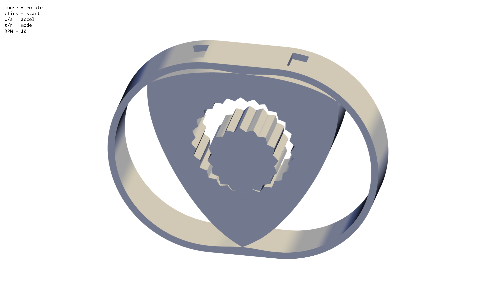

# rotary-simulation

A tiny rotary simulation for [shrink](https://shrink.hackclub.com/).

**Features**
- Generated 3D model and cool shaders via [WebGL 2](https://developer.mozilla.org/en-US/docs/Web/API/WebGL_API)
- Simulated audio through the [Web Audio API](https://developer.mozilla.org/en-US/docs/Web/API/Web_Audio_API)
- Event hooks for user control of the simulation
- Tested on Firefox and Chrome

To try the simulation out, copy the contents of [uri.txt](./dist/uri.txt) into a browser search bar.  
You can see some of the math behind the simulation on [desmos](https://www.desmos.com/calculator/dbaxm233my).

### Building
Prerequisites: [Bun](https://bun.sh/), [Git](https://git-scm.com/)

```shell
git clone https://github.com/Protract-123/rotary-simulation.git
cd rotary-simulation
bun install

# open preview url
bun run dev

# build uri
bun run build
```

### Screenshot


### License

rotary-simulation is released under the [MIT License](LICENSE).
